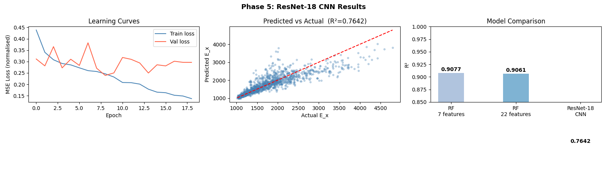
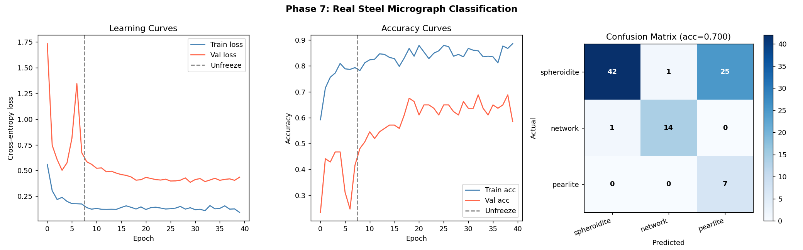
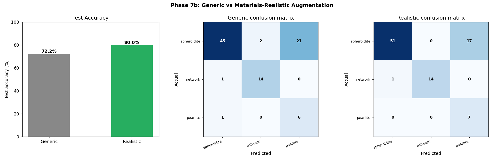
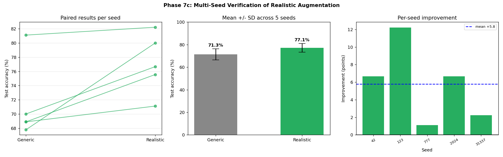
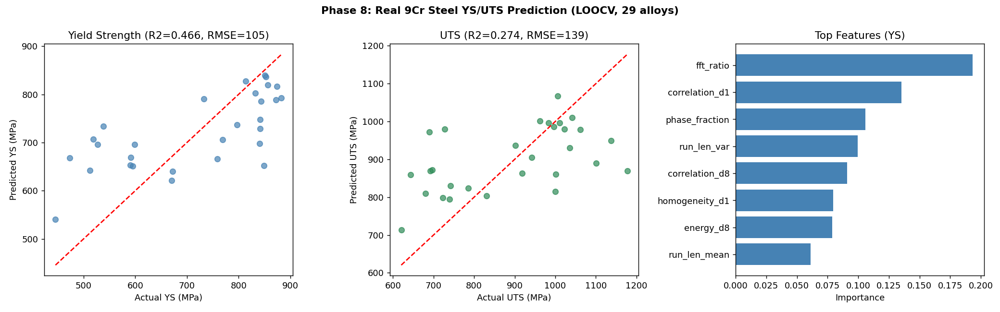
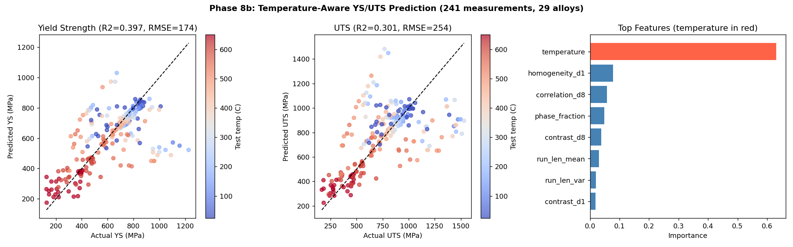
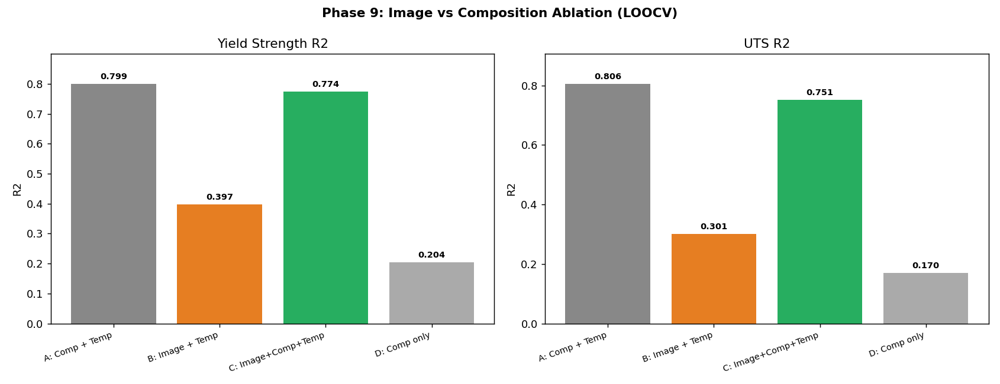

# Predicting Mechanical Properties from Steel Microstructure Images

A machine learning pipeline that predicts mechanical properties directly from microstructure images, built and validated across both synthetic and real steel datasets. The project progresses from a synthetic proof of concept to a rigorous test on real 9% Cr steel, and ends with a controlled ablation answering a precise scientific question: **do microstructure images add predictive value beyond chemical composition?**

The headline finding across every phase is consistent and somewhat against the grain of the deep-learning hype: **domain-informed hand-crafted features matched or beat convolutional neural networks for this task, especially when data was limited.**

---

## Table of Contents
- [Motivation](#motivation)
- [Datasets](#datasets)
- [Pipeline Overview](#pipeline-overview)
- [Phase-by-Phase Results](#phase-by-phase-results)
- [Key Findings](#key-findings)
- [Limitations](#limitations)
- [Repository Structure](#repository-structure)
- [How to Run](#how-to-run)

---

## Motivation

Measuring the yield strength (YS) and ultimate tensile strength (UTS) of a steel normally requires destructive mechanical testing. If those properties could be predicted directly from a microstructure image, it would save time, material, and cost. This project builds that pipeline, starting on synthetic data where ground truth is clean, then testing whether it transfers to real steel.

---

## Datasets

**MICRO2D (synthetic).** 87,379 synthetic two-phase microstructures across 10 morphology classes from Georgia Tech (Kalidindi group). Each is a 256x256 binary image with 42 homogenized properties computed by finite element simulation. Target: longitudinal elastic modulus E_x, used as a clean stand-in for strength.

**UHCS (real, classification).** 598 real ultra-high carbon steel micrographs from Carnegie Mellon, labeled by microstructure class (spheroidite, network, pearlite). No mechanical property labels.

**NETL 9% Cr steel (real, regression).** 837 micrographs across 29 usable alloys with paired YS and UTS measurements and full chemical composition, released by the US DOE National Energy Technology Laboratory (Rozman et al., Data in Brief 2022). This is the real-data analog of the synthetic MICRO2D task.

---

## Pipeline Overview

The core pipeline extracts 15 hand-crafted features from each microstructure image:
- Intensity statistics (mean, texture variance)
- Edge density (Canny)
- Gray-Level Co-occurrence Matrix features at distances 1 and 8 (contrast, homogeneity, energy, correlation)
- Phase fraction (Otsu threshold on real images)
- FFT low-frequency energy ratio
- Run-length mean and variance (grain-size proxies)

These feed a Random Forest regressor. CNN variants (ResNet-18 transfer learning, and a hybrid combining both) were tested as alternatives at every stage.

---

## Phase-by-Phase Results

### Phases 1-4: Synthetic Baseline (Random Forest)

| Model | R² | RMSE |
|---|---|---|
| RF, 7 features | 0.908 | 186 |
| RF, 22 features | 0.906 | 188 |

Adding more features beyond the original seven gave no improvement. Feature importance showed GLCM energy alone carried over 60% of the predictive weight. The hand-crafted features had hit a natural ceiling around R² 0.91.

### Phase 5: CNN Transfer Learning



| Model | R² | RMSE |
|---|---|---|
| ResNet-18, 10k GRF images | 0.764 | 306 |
| ResNet-18, all 87k images, freeze/unfreeze | 0.840 | 189 |

The first CNN overfit badly on 10k images. Scaling to all 87k with a freeze-then-unfreeze training strategy stabilized training and reached R² 0.84, but it still did not beat the Random Forest.

### Phase 6: Hybrid Model and Ablation

A hybrid model concatenated ResNet's 512-dim visual features with the 15 hand-crafted features. It reached R² 0.925. But a controlled ablation delivered the key verdict:

| Model | R² | RMSE |
|---|---|---|
| Hand-crafted features only (RF) | **0.936** | **118** |
| CNN backbone only | -0.386 | 551 |
| Hybrid (image + features) | 0.925 | 129 |

**The CNN contributed nothing.** Hand-crafted features alone were the best model on synthetic data. Adding the image stream slightly hurt performance. For binary two-phase microstructures where the modulus is governed by phase fraction and spatial arrangement, features that measure those quantities directly beat a CNN forced to rediscover them from pixels.

### Phase 7: Real Steel Classification



A ResNet-18 with a magnification embedding classified real UHCS micrographs into three microstructure classes at **70% accuracy**. Network microstructures were identified near perfectly (precision and recall both 0.93); spheroidite and pearlite were sometimes confused, as they are genuinely visually similar at some magnifications. A respectable baseline given 598 images, 27 magnification levels, and heavy class imbalance.

### Phase 7b/7c: Materials-Realistic Data Augmentation

*This phase came out of a conversation with a researcher at Oak Ridge National Laboratory, who pointed out that augmentation techniques borrowed from natural-image tasks are often inadequate for materials data — the distortions need to be handcrafted to model what actually happens during imaging.*

Phase 7 used generic augmentation (flips, rotations, color jitter). Phase 7b replaced it with six augmentations that each simulate a real micrograph collection artifact:

| Augmentation | Physical origin |
|---|---|
| Gamma correction | Etching time/strength varies phase contrast nonlinearly |
| Illumination gradient | Uneven microscope lighting across the field of view |
| Vignette | Radial edge darkening in optical microscopy |
| Gaussian blur | Focus variation across a sample |
| Gaussian noise | Camera sensor grain |
| Scale jitter | Magnification differences between imaging sessions |

Flips and 90° rotations were kept — unlike the others, they are physically valid observations of an isotropic sample rather than artifacts.



**Single-run result:** 72.2% → 80.0% (+7.8 points), with the gain coming from the targeted failure mode. Spheroidite recall rose from 0.66 to 0.75 as etching and focus augmentation taught the model to ignore the imaging artifacts that make fine spheroidite resemble unresolved pearlite.

**Multi-seed verification:** Because a 90-image test set makes 7.8 points equal to roughly 7 images, both strategies were rerun across five seeds, with each seed changing the data split as well as model initialization.



| Seed | Generic | Realistic | Δ |
|---|---|---|---|
| 42 | 70.0% | 76.7% | +6.7 |
| 123 | 67.8% | 80.0% | +12.2 |
| 777 | 81.1% | 82.2% | +1.1 |
| 2024 | 68.9% | 75.6% | +6.7 |
| 31337 | 68.9% | 71.1% | +2.2 |
| **Mean** | **71.3% ± 4.9** | **77.1% ± 3.8** | **+5.8** |

Realistic augmentation won in **5 of 5 seeds** (paired t = 2.93, p ≈ 0.04). The directional consistency is stronger evidence than the significance test itself, which has limited power at n=5. Realistic augmentation also **reduced variance across seeds** (SD 3.8 vs 4.9), meaning more stable models across different data partitions — an independent signal that the effect is genuine.

The improvement required no architecture change, no extra data, and no hyperparameter tuning. It came entirely from modeling the physics of micrograph collection rather than treating micrographs as generic photographs.

### Phase 8: Real Steel YS/UTS Regression

The first real test of the property-prediction pipeline. Because each alloy has many near-identical images sharing one label, all evaluation uses **Leave-One-Alloy-Out cross validation** so the model is always tested on an alloy it never saw.



**Phase 8a (room temperature, image features only):**

| Target | R² | RMSE |
|---|---|---|
| Yield Strength | 0.466 | 105 MPa |
| Ultimate Tensile Strength | 0.274 | 139 MPa |

Predicting room-temperature YS from microstructure images alone on real steel reached R² 0.47. The model handled the majority CPJ alloys well and over-predicted the minority low-strength families, a data-imbalance effect.



**Phase 8b (temperature added as input):** Extending to all test temperatures (24°C to 650°C) across 241 measurements, test temperature dominated feature importance at 63%, which is physically correct since steel strength falls sharply with temperature.

### Phase 9: Does Microstructure Add Value Beyond Composition?

The central scientific question, answered with a four-way ablation under Leave-One-Alloy-Out cross validation.



| Model | YS R² | UTS R² |
|---|---|---|
| Composition + Temperature | **0.799** | **0.806** |
| Image + Temperature | 0.397 | 0.301 |
| Image + Composition + Temperature | 0.774 | 0.751 |
| Composition only | 0.204 | 0.170 |

Composition plus temperature predicted real 9Cr steel strength at R² 0.80. **Adding image features did not help** — it slightly lowered R². For this dataset, the microstructure images carried no predictive information beyond what chemical composition already encoded.

Crucially, this result has three competing explanations that the experiment cannot separate: (1) genuine redundancy, (2) too few alloys (29) to learn the high-dimensional image mapping, or (3) optical resolution too coarse to capture the relevant features. Distinguishing them would require more alloys, higher-resolution imaging, or a set of alloys with identical composition but different heat treatments. An attempt to find such a controlled set within the CPJ-7 variants showed they vary composition by design and mostly lack images, so the clean experiment was not possible with this data.

---

## Key Findings

1. **Hand-crafted features beat CNNs** for microstructure property prediction across both synthetic and real data, especially at limited data sizes. On synthetic data a Random Forest reached R² 0.94, beating every CNN variant including a hybrid.

2. **Domain-informed augmentation beats generic augmentation.** Replacing photo-style augmentation with six transforms that model real micrograph collection artifacts improved classification accuracy by 5.8 points and reduced variance across seeds, winning in 5 of 5 independent runs — with no change to architecture, data, or hyperparameters.

3. **Honest evaluation matters.** Alloy-grouped cross validation prevented the data leakage that a naive image-level split would have caused, keeping the real-data results trustworthy.

4. **Composition dominates for 9Cr steels.** Chemistry plus test temperature predicted strength at R² 0.80, and microstructure images added no measurable value on top, a precise negative result that is stated with its confounds rather than overclaimed.

---

## Limitations

- Synthetic MICRO2D results (R² 0.94) are an optimistic upper bound; real micrographs have noise and artifacts absent from synthetic data.
- The 9Cr dataset has only 29 usable alloys, imbalanced toward high-strength CPJ steels.
- Images and labels pair at the alloy level, so the effective sample size for learning is the number of alloys, not images.
- The Phase 9 negative result cannot distinguish genuine redundancy from insufficient data or imaging resolution.
- The augmentation result is significant at p ≈ 0.04 with only five seeds, so the direction is consistent but the exact magnitude remains uncertain.

---

## Repository Structure

```
scripts/      feature extraction, RF training, CNN variants, ablations
outputs/      result figures, feature CSVs, per-class and prediction tables
data/         (not tracked — large datasets downloaded separately)
```

---

## How to Run

```bash
pip install -r requirements.txt
```

Key scripts in order of the project arc:
- `extract-features.py` — extract hand-crafted features from images
- `train_model.py` — train and evaluate the Random Forest
- `CNN.py`, `CNN_2.py`, `CNN v3.py` — CNN and hybrid variants
- `ablation.py` — Phase 6 image-vs-features ablation
- `Classify.py` — Phase 7 real-steel classification
- `phase7b_realistic_aug.py` — materials-realistic augmentation A/B comparison
- `phase7c_multiseed.py` — multi-seed verification of the augmentation result
- `phase8_train.py`, `phase8b_train.py` — real 9Cr steel YS/UTS regression
- `phase9_ablation.py` — image vs composition ablation
- `predict.py` — load a saved model and predict on a new image

---

Vishwak Naramreddy (UMD Materials Science & Engineering)

## Acknowledgements

Datasets: MICRO2D (Georgia Tech, Kalidindi group), UHCS (Carnegie Mellon), and the 9% Cr steel dataset (US DOE NETL). This project was developed as a research effort to apply machine learning to materials microstructure-property relationships.

**References**

Robertson, A.E., Generale, A.P., Kelly, C., Buzzy, M.O., Kalidindi, S.R. "MICRO2D: A Large, Statistically Diverse, Heterogeneous Microstructure Dataset." *Integrating Materials and Manufacturing Innovation*, 2024.

DeCost, B., Hecht, M., Francis, T., Webler, B., Picard, Y., Holm, E. "UHCSDB: UltraHigh Carbon Steel Micrograph DataBase: Tools for Exploring Large Heterogeneous Microstructure Datasets." *Integrating Materials and Manufacturing Innovation*, vol. 6, 2017. DOI: 10.1007/s40192-017-0097-0

Rozman, K.A. et al. "9% Cr steel micrograph and mechanical property dataset." *Data in Brief*, 2022.
